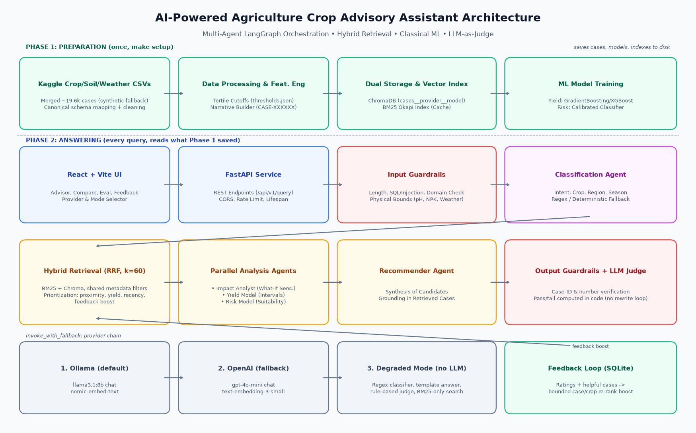
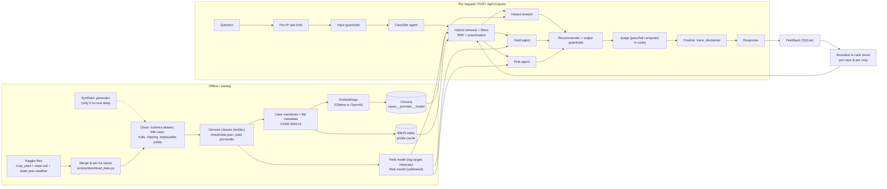
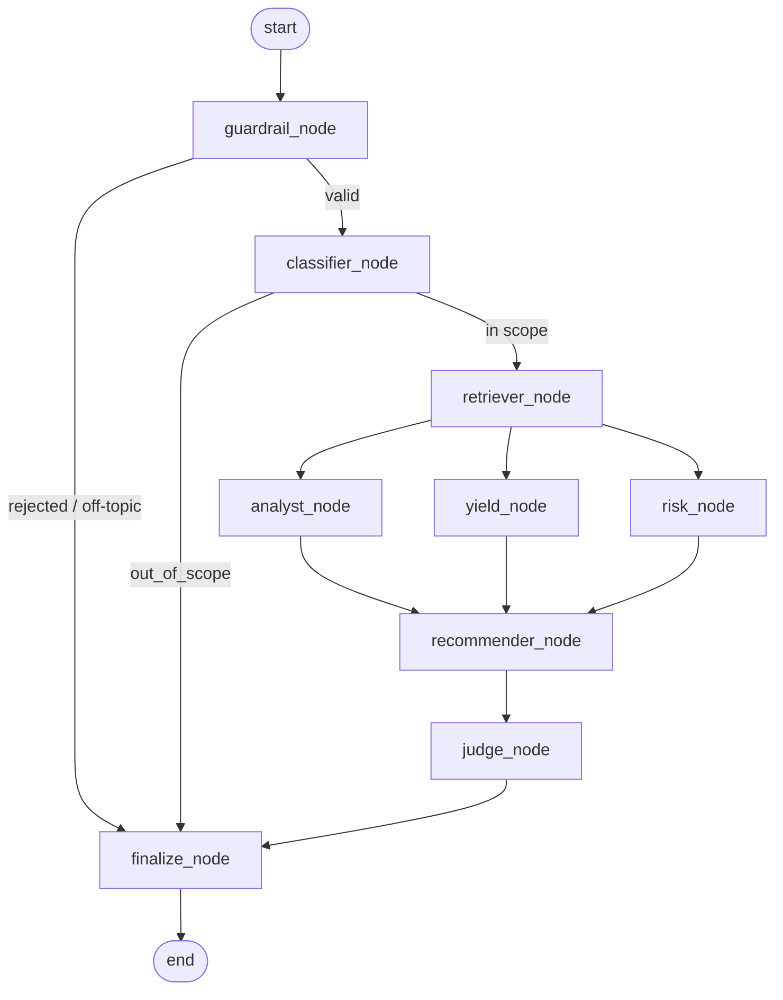
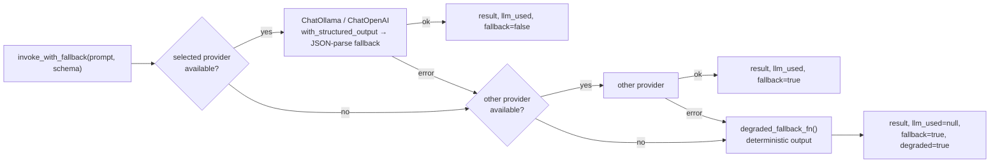

# Architecture

Static diagram: `architecture.png` / `.jpg` / `.pdf`, generated by `scripts/make_architecture_diagram.py`. The Mermaid sources below are the reference.

## 1. End-to-end data flow

## 2. LangGraph multi-agent workflow

`backend/app/agents/graph.py` compiles one `StateGraph` over the `AdvisoryState` TypedDict (`agents/state.py`). Every node is a plain function that returns a partial state update. `trace` uses an `operator.add` reducer, so the parallel branches append their own timing entries. `GET /api/v1/graph` returns the compiled graph as Mermaid.

> **No revision loop.** `check_judge_condition` in `graph.py` always routes `judge_node` to `finalize_node`. The judge verdict is reported, but it does not trigger a rewrite. This keeps every in-scope query at exactly three LLM calls (classifier, recommender, judge), so latency and evaluation runs are predictable. `generate_crop_recommendation` still accepts a `critique` argument and `AdvisoryState` still has `revision_count`, so the loop can be re-enabled by changing that one routing function. `revision_count` now only counts judge passes.

| Node | Responsibility | LLM? |
|---|---|---|
| `guardrail_node` | length/control-char checks, prompt-injection screen, domain check, physical bounds of numbers found in the text (deterministic extractor) | no |
| `classifier_node` | `QueryClassification` via `.with_structured_output`; regex extractor in degraded mode; normalises crop/state/season to dataset values; "did you mean" warnings | yes |
| `retriever_node` | merges explicit + classifier filters, hybrid search, prioritization, progressive filter relaxation (4 levels), per-state retrieval (up to 3 states) for multi-state yield-gap questions | embeddings |
| `analyst_node` | permutation importance + what-if sensitivity for the target crop; for `explain_yield_difference` questions also runs `analyze_yield_gap` and sets `yield_gap` | no |
| `yield_node` | yield + 10–90% interval for each candidate crop (at most 5, `MAX_CANDIDATE_CROPS`) | no |
| `risk_node` | P(low yield), level, envelope factors per candidate crop; envelope checks only cover conditions the user stated | no |
| `recommender_node` | per-crop aggregation (top 5), grounded explanation, citation and number guardrails, template in degraded mode; in yield-gap mode it explains the gap instead of recommending crops | yes |
| `judge_node` | `JudgeVerdict` (grounded / consistent / actionable / safe, 1–5); `passed` is recomputed in code (all ≥ 3 and mean ≥ 3.5); rule-based validator in degraded mode; optional separate `JUDGE_PROVIDER` / `JUDGE_MODEL` | yes |
| `finalize_node` | disclaimer, out-of-scope notice, final trace entry | no |

Routing: `guardrail_node` sends rejected input (or off-topic input, which sets `out_of_scope`) straight to `finalize_node`. `classifier_node` does the same for `intent == out_of_scope`. In `POST /query`, a rejected, non-out-of-scope request becomes an HTTP 400/422 with the guardrail's code; out-of-scope returns 200 with `out_of_scope: true`.

Farm profiles for the yield, risk and impact agents start from the values the user stated. Missing values come from the retrieved cases of that crop (median numerics, most common season and state), then from the crop's historical medians (`complete_profile`). There are no hard-coded defaults. For `alternative_crop` questions the crop the user wants to replace is excluded from the candidates.

## 3. LLM provider abstraction and fallback

- `llm/factory.py`: `get_chat_model`, `get_embeddings`, `list_providers` (Ollama pinged at `/api/tags` with a 2 s timeout; OpenAI available only if a key is set).
- Judge calls use `JUDGE_PROVIDER` / `JUDGE_MODEL` when set; otherwise the chat model selected for the request.
- `get_embeddings` **never substitutes** another provider or a fake model. It raises `EmbeddingProviderUnavailable`, and retrieval then degrades to BM25, with a warning in the response.
- Each embedding provider/model has its own Chroma collection, so vectors of different dimensions (768 vs 1536) never mix.

## 4. Retrieval and ranking

1. **Filters** (`retrieval/filters.py`): the same `MetadataFilters` become a Chroma `where` clause (`$and` / `$in` / `$gte` / `$lte`) and an in-memory predicate for BM25 pre-filtering.
2. **Candidates**: BM25 and Chroma each return up to `max(10·top_k, 100)` filtered candidates. BM25 tokens exclude stopwords and bare numbers (years are kept).
3. **Fusion**: Reciprocal Rank Fusion, `(1-α)/(60+rank_vec) + α/(60+rank_bm25)`, α = `HYBRID_ALPHA`, min-max normalised.
4. **Prioritization** (`retrieval/ranking.py`), with weights `RANKING_W1..W6` (defaults 0.35, 0.25, 0.20, 0.10, 0.10, 0.30):
   `final = (w1·retrieval + w2·condition_proximity + w3·yield_percentile + w4·recency + w5·feedback + w6·prevalence) / Σw`.
   - Proximity uses only the numeric conditions the user supplied.
   - Recency is scaled to the dataset's year range.
   - The feedback boost is case boost + crop boost, bounded to ±0.1 and mapped to [0, 1].
   - **Prevalence** is `sqrt(crop's planted area / area of the most-planted crop)` in the case's state and season, so widely grown crops outrank rare ones (0.5 if unknown; `RANKING_W6 = 0` disables it).
   - Roll-up labels such as "Oilseeds Total" or "Other Kharif Pulses" are dropped (`is_aggregate_crop`).
   - Every case carries its score breakdown.
5. **Diversity**: without a crop filter, at most `max(2, (top_k + 2) // 3)` cases per crop are returned, so alternatives stay visible. If that leaves fewer than `top_k`, the best skipped cases are added back.
6. **Relaxation** (`nodes.py::build_filters`): if fewer than `min(3, top_k)` cases match, the classifier-derived filters are dropped in four levels:
   0. state, season, crop and derived soil/weather classes
   1. state, season, crop
   2. state only
   3. explicit request filters only

   Explicit request filters are never dropped. The crop filter is not applied for `alternative_crop` questions, and it is never relaxed for `explain_yield_difference` questions.
7. **Aggregation** (`agents/recommender.py::aggregate_crop_recommendations`): cases are grouped by crop. The crop score is the mean final case score plus a multi-case bonus of `min(0.05, 0.01·(n-1))`. The top 5 crops are returned.

## 5. Guardrails

- **Input** (`guardrails/input_validation.py`): 5–1000 chars, control characters stripped, injection patterns → 400, numeric bounds (pH 0–14, N/P/K 0–500, temperature −10–55 °C, rainfall 0–5000 mm, humidity 0–100 %) → 422 with a field-specific code, off-topic (no agriculture keyword, crop or state mentioned) → `out_of_scope`, crop/state fuzzy matching and aliases ("mustard" → `Rapeseed &Mustard`, "Maharastra" → `Maharashtra`), notices for Indian states missing from the dataset, per-IP sliding-window rate limit (`RATE_LIMIT_PER_MINUTE`, default 60), enforced in the `/query` endpoint.
- **Output** (`guardrails/output_validation.py`): case IDs not in the retrieved set are neutralised. Sentences quoting numbers that cannot be traced to the retrieved cases, model outputs or the question are removed. Small integers up to 10 (list numbering, "top 3") are not treated as data claims. If more than half of the numeric sentences fail, the deterministic template is used instead. Every response carries the disclaimer.
- **Judge** (`agents/judge.py`): a second opinion after the guardrails. In degraded mode `rule_based_judge` checks that cited IDs are in the retrieved set, that each crop's historical median fits its predicted interval (half of the low bound to double the high bound), and that every recommendation has yield and risk estimates.

## 6. Machine learning

| Component | Details |
|---|---|
| Features | crop, season, state (one-hot) + N, P, K, pH, temperature, rainfall, humidity, fertilizer, pesticide, area, year |
| Split | time-aware: the most recent ~20% of rows by year are the test set (train < 2016, test ≥ 2016 on the real data) |
| Yield | GradientBoosting (XGBoost when its native library loads) on `log1p(yield)`. Interval = prediction × exp(10th/90th percentile of held-out log residuals), per crop when ≥ 15 test residuals exist |
| Risk | target `yield < crop's 25th percentile`, isotonic-calibrated classifier (3-fold) + crop 10th–90th percentile envelope checks on the conditions the user stated. Level is `low` if P < 0.25 and no envelope breaches, `medium` if P < 0.5 with at most one breach and none "high" (> 30% outside the envelope), otherwise `high`. The top 3 breaches are returned as factors |
| Impact | permutation importance (R² drop on log yield, ≤ 400 rows of the crop) + ±20% one-at-a-time what-if (±10% for pH) |
| Yield gap | `ml/yield_gap.py::analyze_yield_gap` compares groups (e.g. two states) for one crop and season from the dataset itself, and supplies example case IDs that count as valid citations |
| Compare | each differing factor of the reference farm is set to the other farm's value; ranked by the predicted yield change |

## 7. Evaluation and feedback

- `evaluation/deepeval_runner.py` runs the golden set (`golden_set.json`, 21 queries over 3 scenarios) through the whole graph. It computes hit-rate@5, recommendation hit-rate and judge pass rate, then DeepEval metrics through `evaluation/judge.py::CustomDeepEvalLLM` (a `DeepEvalBaseLLM` around the LangChain chat model). Jobs run in a background thread with per-sample timeouts (`EVAL_TIMEOUT_SECONDS`), retries (`EVAL_MAX_RETRIES`) and resumable checkpoints. `EVAL_METRICS` selects the DeepEval metrics (default `answer_relevancy,crop_recommendation_quality`; `all` adds faithfulness and the two contextual metrics). If no LLM is reachable, retrieval metrics and the rule-based judge still run, DeepEval is skipped, and runs are marked degraded (`degraded_runs` in the aggregate).
- `feedback/store.py` (SQLite) stores ratings. `feedback/reranker.py` turns them into Laplace-smoothed boosts per case and per crop. This is a re-ranking signal, not retraining. `POST /admin/retrain` retrains the ML models from data.

## 8. Startup and index lifecycle

`main.py::lifespan` runs on every start:

1. `init_db()` creates the SQLite feedback table.
2. `get_active_dataframe()` loads the processed parquet, or re-processes the raw data if it changed (real Kaggle files replace a synthetic dataset automatically).
3. `get_bm25_retriever(docs)` loads the pickled BM25 index, rebuilding it when the tokenizer version or data changed.
4. If the Chroma collection for the default embedding provider/model has fewer documents than the dataset, `start_index_job(force_reindex=False)` resumes indexing in a background thread. If the provider is down, startup only logs a warning. Until the index is ready, hybrid and semantic requests fall back to keyword search and say so in `warnings` and `search_mode_used`.
5. The yield and risk predictors are loaded (and trained first if the model files are missing or built for another dataset).

Middleware adds a request ID and structured logging, plus CORS from `CORS_ORIGINS` and handlers that return errors in one JSON shape.

## 9. API surface (`api/v1/router.py`, prefix `/api/v1`)

| Group | Endpoints |
|---|---|
| Pipeline | `POST /query` (full graph), `GET /graph` (Mermaid) |
| Single-purpose | `POST /search`, `POST /classify`, `POST /recommend`, `POST /predict/yield`, `POST /predict/risk`, `POST /analyze/impact`, `POST /compare` |
| Metadata | `GET /health`, `GET /providers`, `GET /metadata/options` |
| Feedback | `POST /feedback`, `GET /feedback/stats` |
| Evaluation | `POST /eval/run`, `GET /eval/status/{run_id}`, `GET /eval/latest` |
| Admin | `GET /admin/index/status`, `POST /admin/reindex`, `GET /admin/reindex/status/{job_id}`, `POST /admin/retrain` |

`/recommend` is the lightweight path: hybrid retrieval, aggregation and a grounded explanation, without the classifier, the parallel analysts or the judge.

## 10. Frontend

React + Vite + TypeScript + Tailwind + Recharts (`frontend/src`). `App.tsx` holds the provider, model, embedding, search mode, top-k and index state, and renders four tabs: **Advisor** (`AdvisorPage`: recommendations, case table, yield-gap panel, impact charts, judge panel, agent trace timeline, feedback widget), **Compare**, **Evaluation** and **Feedback**. `api/client.ts` wraps the REST calls, and `SyntheticBanner` warns when synthetic data is in use.
