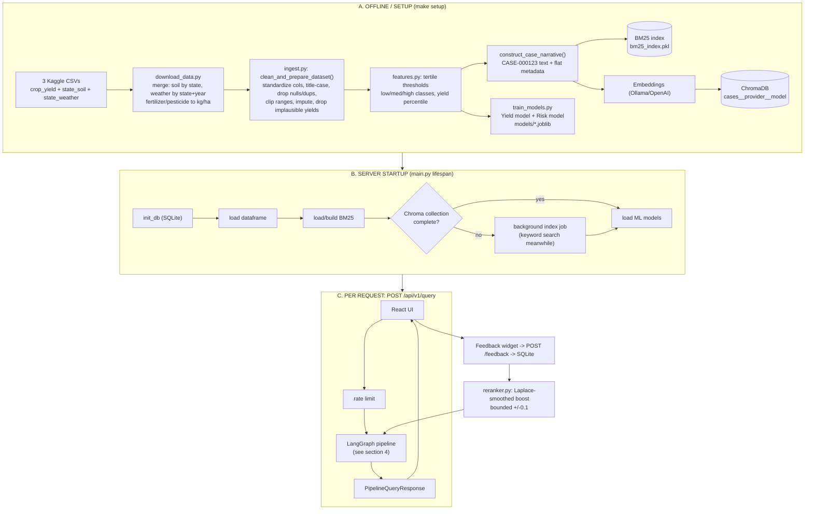
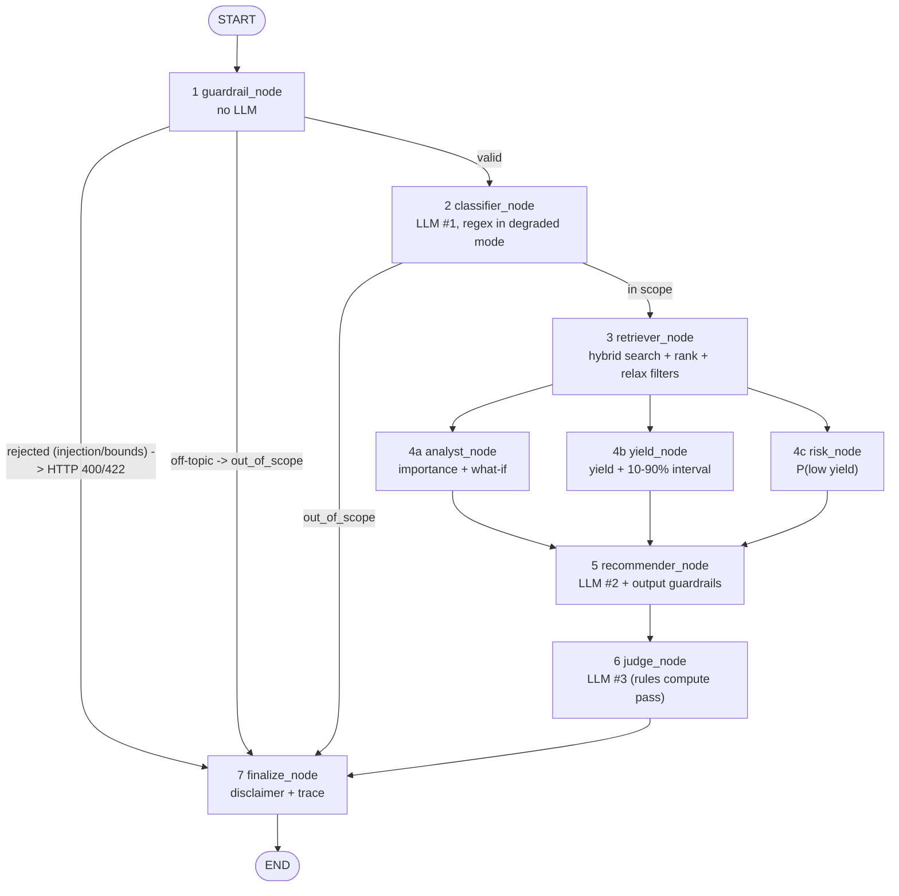
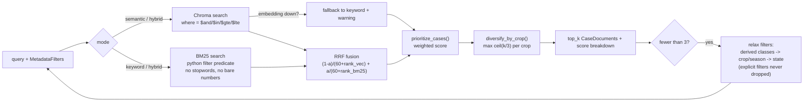
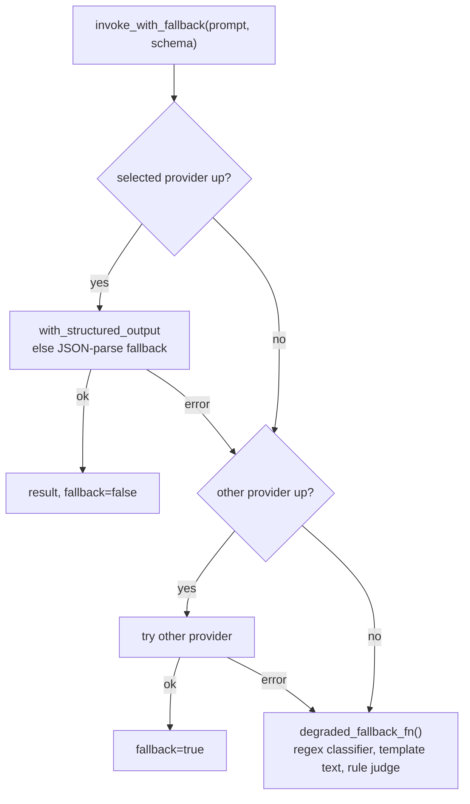

# Intern Guide: AI-Powered Agriculture Crop Advisory Assistant

Written for: a new intern who needs the whole project explained, step by step. View the flowcharts in VS Code with a Mermaid preview extension, or on GitHub.

---

## 0. The 30-second pitch

A farmer (or officer) types a plain-English question, e.g. *"Which crops do well in Punjab during Kharif with N around 90, pH 6.5 and 1200 mm rain?"*

The system:
1. checks the question is safe and on-topic,
2. understands it (crop, state, season, numbers),
3. finds the most similar **historical farming cases** (about 19.6k real Indian state-season-year records),
4. runs **ML models** for yield (with a range) and low-yield risk,
5. explains which soil/weather/input factors matter,
6. writes a **grounded** explanation, checks it with guardrails and an LLM judge,
7. shows everything in a React UI and lets the user rate the answer.

**Golden rule of the design:** the LLM only does *wording and understanding*. Every number comes from data or trained ML models. If no LLM is available, the app still answers in "degraded mode".

---

## 1. Tech stack

| Layer | Tech | Why |
|---|---|---|
| API | FastAPI, Pydantic v2, Uvicorn | Typed requests and responses, auto docs at `/docs` |
| Orchestration | LangGraph `StateGraph` + LangChain | Explicit control flow: early exits, parallel branches, traceable nodes |
| LLMs | Ollama (`llama3.1:8b`) by default, OpenAI (`gpt-4o-mini`) optional | Local, private, free first; cloud as backup |
| Embeddings | Ollama `nomic-embed-text` (768-d) or OpenAI `text-embedding-3-small` (1536-d) | Semantic search |
| Vector DB | ChromaDB (persistent, embedded) | Metadata filters plus no extra server |
| Keyword search | `rank_bm25` | Exact tokens (crop, state, year) |
| Fusion | Reciprocal Rank Fusion (RRF) | Rank-based, so it works with any embedding model |
| ML | scikit-learn GradientBoosting (XGBoost if it loads), isotonic calibration | Tabular data, measurable, explainable |
| Data | pandas, parquet, Kaggle "Crop Yield with Soil and Weather" | Real data, with a synthetic fallback |
| Evaluation | DeepEval plus a golden set of 21 queries | Measures retrieval and answer quality |
| Feedback | SQLite via SQLAlchemy | Ratings become small ranking boosts |
| Frontend | React 18, Vite, TypeScript, Tailwind, Recharts | 4-tab UI |
| Infra | Docker Compose, Makefile, pytest | One-command setup and tests |

---

## 2. Repository map

```
agri_assistant/
├── backend/app/
│   ├── main.py            FastAPI app, startup (lifespan), middleware, error handlers
│   ├── config.py          All settings (.env): models, paths, ranking weights
│   ├── api/v1/router.py   All 20 REST endpoints
│   ├── schemas/           Pydantic request/response models
│   ├── data/              ingest.py (clean, narratives), features.py (tertiles), schema.py (column aliases)
│   ├── retrieval/         bm25.py, vectorstore.py (Chroma), hybrid.py (RRF), ranking.py, filters.py
│   ├── llm/               factory.py (providers), fallback.py (invoke_with_fallback)
│   ├── agents/            graph.py, nodes.py, state.py, classifier.py, recommender.py, judge.py, prompts.py
│   ├── ml/                yield_model.py, risk_model.py, impact.py, yield_gap.py, features.py
│   ├── guardrails/        input_validation.py, output_validation.py
│   ├── feedback/          store.py (SQLite), reranker.py (boosts)
│   └── evaluation/        deepeval_runner.py, judge.py, golden_set.json
├── scripts/               download_data.py, train_models.py, build_index.py, run_eval.py, generate_synthetic_data.py
├── frontend/src/          App.tsx, pages/ (Advisor, Compare, Evaluation, Feedback), components/, api/client.ts
├── data/                  raw, processed (parquet, thresholds, bm25 pickle), chroma, eval, feedback.db
├── data_set/              the 3 Kaggle CSVs
├── models/                yield_model.joblib, risk_model.joblib, metrics.json
├── docs/                  ARCHITECTURE, DESIGN, ASSUMPTIONS, DATA_PROFILE, DEMO_SCRIPT
└── Makefile, docker-compose.yml
```

Commands: `make install` → `make setup` (data, train, index) → `make dev` (backend :8000, frontend :5173). `make test`, `make eval`.

---

## 3. The big picture flowchart



---

## 4. The per-request pipeline (LangGraph), the heart of the project

Files: `agents/graph.py` (wiring), `agents/nodes.py` (node functions), `agents/state.py` (`AdvisoryState` TypedDict).



> **Note:** there is no judge-to-recommender revision loop. `check_judge_condition` in `graph.py` **always goes to finalize**. The loop is disabled so every query makes exactly 3 LLM calls (classifier, recommender, judge), which keeps eval latency predictable. Say this if asked.

### Step 1: `guardrail_node` (no LLM)
- **Key methods:** `sanitize_and_validate_query_text`, `is_domain_relevant`, `extract_conditions_regex`, `validate_numeric_bounds` (all in `guardrails/input_validation.py` and `agents/classifier.py`).
- **What happens:** length 5 to 1000 chars, strip control characters, block prompt-injection patterns, check the question is about agriculture, extract numbers by regex and check physical bounds (pH 0 to 14, humidity 0 to 100, and so on).
- **Strategy:** cheap deterministic checks *before* spending LLM time. Injection returns 400, bad numbers return 422 with a field-specific code, off-topic returns 200 with `out_of_scope: true`.

### Step 2: `classifier_node`
- **Key methods:** `classify_query`, `normalize_classification`, `merge_with_rule_based` (`agents/classifier.py`); `classification_warnings` (`nodes.py`).
- **What happens:** the LLM fills a `QueryClassification` (intent, crop, state, season, soil N/P/K/pH, weather, excluded crops) via `.with_structured_output`.
- **Strategy:** (1) the LLM result is *merged with a regex extractor*, so numbers never depend on the LLM alone; (2) values are normalised to dataset spellings (fuzzy match, aliases: "mustard" becomes `Rapeseed &Mustard`, "Maharastra" becomes `Maharashtra`); (3) "did you mean" warnings and notices for states not in the data (e.g. Rajasthan).

### Step 3: `retriever_node`
- **Key methods:** `_retrieve_with_relaxation`, `build_filters` (`nodes.py`); `search_with_mode`, `reciprocal_rank_fusion` (`retrieval/hybrid.py`); `prioritize_cases`, `diversify_by_crop` (`retrieval/ranking.py`); `search_vectorstore`; `BM25Retriever.search`.
- Detailed flow in section 5.
- **Strategies:** hybrid search, metadata pre-filtering, multi-signal ranking, diversity cap, progressive filter relaxation, and per-state retrieval for "why is Punjab's yield higher than Bihar's?" questions.

### Step 4: three parallel analysts (fan-out)
LangGraph runs these at the same time; the trace list merges via an `operator.add` reducer.

| Node | Key methods | What it does |
|---|---|---|
| `analyst_node` | `perform_impact_analysis`, `compute_global_importance`, `compute_what_if_sensitivity` (`ml/impact.py`) | Permutation importance (R² drop on log-yield, up to 400 rows) plus ±20% one-at-a-time what-if (±10% for pH) |
| `yield_node` | `CropYieldPredictor.predict_one` (`ml/yield_model.py`) | Predicted yield plus 10 to 90% interval for each candidate crop |
| `risk_node` | `CropRiskPredictor.assess_risk` (`ml/risk_model.py`) | P(yield below crop's 25th percentile), risk level, and "envelope" checks against the crop's historical 10 to 90% ranges |

- **`farm_profile()` strategy:** fields the user stated come first, then medians of the retrieved cases for that crop, then the crop's historical medians. **No hard-coded defaults.**
- Also, `analyze_yield_gap` (`ml/yield_gap.py`) handles state-vs-state comparisons.

### Step 5: `recommender_node` (fan-in)
- **Key methods:** `aggregate_crop_recommendations`, `generate_crop_recommendation`, `build_deterministic_recommendation_text`, `_allowed_numbers` (`agents/recommender.py`); `format_verified_response`, `strip_unverified_numbers`, `validate_and_sanitize_citations` (`guardrails/output_validation.py`).
- **What happens:** groups retrieved cases by crop, scores them, attaches yield and risk, and asks the LLM to write a grounded explanation citing `CASE-xxxx` IDs.
- **Output guardrail strategy:**
  - unknown case IDs are neutralised;
  - any sentence with a number not traceable to the cases, model outputs or the question is removed;
  - if more than half of the numeric sentences fail, the **deterministic template** replaces the LLM text.

### Step 6: `judge_node`
- **Key methods:** `evaluate_recommendation`, `rule_based_judge` (`agents/judge.py`).
- **What happens:** the LLM scores *grounded, consistent_with_data, actionable, safe* (1 to 5).
- **Strategy:** **pass/fail is computed in code** (all ≥ 3 and mean ≥ 3.5); the model's own `passed` flag is ignored because small models are lenient. Degraded mode uses a rule-based validator (citations, median-vs-interval consistency, completeness). A separate judge model can be set with `JUDGE_PROVIDER` / `JUDGE_MODEL`.

### Step 7: `finalize_node`
Adds the disclaimer, the out-of-scope message if needed, and the final trace entry. The router (`execute_query`) then builds `PipelineQueryResponse`: classification, similar cases, recommendations, impact analysis, yield gap, explanation, judge, `agent_trace`, `llm_used`, `fallback_triggered`, `degraded_mode`, `warnings`, `filters_applied`, `search_mode_used`, `is_synthetic_data`, `disclaimer`.

---

## 5. Retrieval and ranking in detail



**Ranking formula** (`retrieval/ranking.py`, weights in `config.py`):

```
final = (0.35·retrieval + 0.25·proximity + 0.20·yield_pct + 0.10·recency + 0.10·feedback + 0.30·prevalence) / sum_of_weights
```

(The 6th weight, **prevalence**, is how widely the crop is grown in that state and season. The score is normalised by the sum of the weights.)

**Strategies and why:**
- *Hybrid:* BM25 is good at exact tokens, vectors at paraphrases. Together they cover both.
- *Numbers in text are weak* for both BM25 and embeddings ("1200 mm" is not near "1150 mm"). So the design uses **metadata filters**, a **proximity score** over only the numbers the user gave, and **tertile words** (low/medium/high) in the narrative.
- *RRF* uses ranks, not raw scores, so no per-model calibration is needed.
- *Chroma collection per embedding model* so 768-d and 1536-d vectors never mix. Embeddings are never silently substituted.

---

## 6. Offline pipeline: data, indexing and ML

1. **Data** (`scripts/download_data.py`, `data/ingest.py`): resolution order is merged CSV, Kaggle files in `data_set/`, Kaggle API, then synthetic (loudly labelled with a UI banner and `is_synthetic_data: true`). Real data: **19,689 raw rows → 19,595 clean, 55 crops, 30 states, 1997 to 2020.** 94 rows with yield over 10× the crop median are dropped as recording errors.
2. **Derived features** (`data/features.py`): tertile thresholds (`thresholds.json`), pH classes, yield percentile within crop.
3. **Case narratives** (`construct_case_narrative`): each row becomes a sentence like *"Rice grown in Punjab during Kharif 2012. Soil: N 150…"* with stable ID `CASE-000123`.
4. **Indexing** (`scripts/build_index.py`, `vectorstore.index_documents`): BM25 pickle and Chroma collection, with retry and a resumable background job (`start_index_job`).
5. **Yield model** (`ml/yield_model.py`): features are crop, season and state (one-hot) plus N, P, K, pH, temperature, rainfall, humidity, fertilizer, pesticide, area and year. It trains on `log1p(yield)`, with a **time-aware split** (train < 2016, test ≥ 2016). Intervals come from per-crop residual quantiles.
6. **Risk model** (`ml/risk_model.py`): target is yield below the crop's 25th percentile, using a calibrated classifier (isotonic).

**Measured results** (`models/metrics.json`):

| Model | Metrics |
|---|---|
| Yield | R² 0.957, R² on log scale 0.94, median abs % error 22.6%, 10 to 90% interval coverage 0.80 (as designed) |
| Risk | accuracy 0.856, ROC-AUC 0.831, Brier 0.107 |

---

## 7. LLM layer and fallback



Files: `llm/factory.py` (`get_chat_model`, `get_embeddings`, `list_providers`, pings Ollama `/api/tags` with a 2 s timeout), `llm/fallback.py`. Every response says `llm_used`, `fallback_triggered`, `degraded_mode`.

---

## 8. Evaluation and feedback

- **Evaluation** (`evaluation/deepeval_runner.py`, `golden_set.json`, `make eval`): 21 golden queries run through the full graph. Metrics are hit-rate@5, recommendation hit-rate, judge pass rate, plus DeepEval metrics (answer relevancy and a custom GEval "crop recommendation quality") via `CustomDeepEvalLLM`. It runs in a background thread with timeouts, retries and checkpoints.
  - **Latest saved run (6 Oct 2026):** hit@5 = 0.619, recommendation hit = 0.81, judge pass = 1.0. **All 21 ran in degraded mode** because no LLM was reachable, so the DeepEval scores are `null`. A degraded judge pass rate of 100% is not strong evidence. Rerun with Ollama up before quoting quality numbers.
- **Feedback** (`feedback/store.py`, `reranker.py`): thumbs and "helpful case" ticks go to SQLite and become Laplace-smoothed boosts per case and per crop, **bounded to ±0.1**. It is a re-ranking nudge, **not** model retraining (`POST /admin/retrain` retrains from data).

---

## 9. Frontend

`frontend/src/App.tsx` holds global state (provider, model, embedding, search mode, top-k, index status) and four tabs:

| Tab | Page | Purpose |
|---|---|---|
| Advisor | `AdvisorPage.tsx` | Ask a question; shows recommendations, case table, yield-gap panel, impact charts, judge panel, agent trace timeline, feedback widget |
| Compare | `ComparePage.tsx` | Two farm profiles, with the factor that changes predicted yield most |
| Evaluation | `EvaluationPage.tsx` | Run and view eval |
| Feedback | `FeedbackPage.tsx` | Feedback stats |

`api/client.ts` wraps the REST calls. The header has the provider/model dropdown (unavailable providers are greyed out with a tooltip), and the gear menu has embedding, search mode, top-k and **Build index**. `SyntheticBanner` warns about fake data.

---

## 10. Key API endpoints (`api/v1/router.py`, prefix `/api/v1`)

`POST /query` (full pipeline) · `POST /search` · `POST /classify` · `POST /recommend` · `POST /predict/yield` · `POST /predict/risk` · `POST /analyze/impact` · `POST /compare` · `POST /feedback` · `GET /feedback/stats` · `POST /eval/run` · `GET /eval/status/{id}` · `GET /eval/latest` · `GET /health` · `GET /providers` · `GET /metadata/options` · `GET /graph` (Mermaid) · `POST /admin/reindex` · `GET /admin/reindex/status/{id}` · `POST /admin/retrain`

---

## 11. Testing

`make test` runs pytest with **no LLM needed**, because the providers are patched with a fake chat model and the feedback DB and eval outputs go to a temp directory. About 60 tests cover API endpoints, hardening/security, guardrails and classifier, retrieval and ranking, ML models, schema and ingest, and the LLM and graph.

---

## 12. Known caveats (say these before someone else finds them)

1. **Correlation, not causation.** "Most sensitive factor" means the model's prediction moves most with that input.
2. **Spatial granularity.** Soil values are one per state and weather is one per state-year, so soil effects are confounded with location.
3. **Rows are state-level aggregates**, not farms. Advice is a regional prior.
4. **Coverage.** 30 states; Rajasthan is missing. Rare crops have wide intervals. Coconut is in nuts/ha.
5. **Revision loop disabled.** The judge verdict is reported but never triggers a rewrite.
6. **Feedback IDs** (`CASE-xxxx`) are stable only per dataset version. Clear feedback when the data changes.

---

# FAQ with gunshot answers

**Q1. What does this project do?**
Takes a plain-English farming question and returns similar historical cases, crop recommendations, yield ranges, risk, factor impact and a grounded, checked explanation.

**Q2. Why LangGraph and not a single LangChain chain?**
The flow has early exits, a parallel fan-out of three analyses, and per-node tracing. `StateGraph` makes that explicit and testable.

**Q3. Why hybrid search?**
BM25 nails exact words (crop, state, year); embeddings catch paraphrases. RRF merges them, and it degrades to BM25 if embeddings are down.

**Q4. Why RRF instead of adding scores?**
BM25 and vector scores are on different, model-dependent scales. RRF uses ranks only, so it needs no calibration.

**Q5. Embeddings are bad with numbers. How do you handle "1200 mm"?**
Metadata filters, a numeric proximity score on the conditions the user gave, tertile words in the narratives, and BM25 that ignores bare numbers.

**Q6. Why ChromaDB?**
Embedded and persistent, has metadata `where` filters, and has first-class LangChain support, so no extra service. The cost is single-node scale.

**Q7. Why one Chroma collection per embedding model?**
Vectors of different models and dimensions (768 vs 1536) are not comparable. Mixing them would corrupt search.

**Q8. Does the LLM predict yield?**
No. Gradient boosting does. The LLM only extracts intent and writes the text, so numbers can't be hallucinated.

**Q9. How do you stop hallucinations?**
Numbers come from data and models; case IDs are validated; sentences with untraceable numbers are deleted; a template replaces the text if more than half fail; then a judge reviews it.

**Q10. How is the judge made trustworthy?**
Pass or fail is computed in code from scores (all ≥ 3 and mean ≥ 3.5), the model's own "passed" is ignored, and a separate judge model can be configured.

**Q11. What if Ollama or OpenAI is down?**
Fallback chain: selected provider, then the other, then degraded mode (regex classifier, template explanation, rule judge). The response flags it.

**Q12. How accurate are the models?**
Yield: R² 0.957 (0.94 on log scale), median error about 22.6%, 10 to 90% interval coverage 0.80. Risk: ROC-AUC 0.83, accuracy 0.856, Brier 0.107. These are on a time-based test (2016 onwards).

**Q13. Why a time-aware split?**
It mimics forecasting a future season and avoids leaking year effects that a random split would.

**Q14. Why predict log yield?**
Yields range from about 0.1 t/ha to about 20,000 nuts/ha. The log keeps crops on comparable terms.

**Q15. How are the prediction intervals made?**
The 10th and 90th percentiles of held-out log residuals, per crop when at least 15 test residuals exist. Measured coverage is 0.80.

**Q16. How does the system explain factor impact?**
Permutation importance (global) and ±20% what-if sensitivity (local). These are associations, not causes.

**Q17. How does user feedback change results?**
It becomes a bounded (±0.1) Laplace-smoothed re-ranking boost per case and per crop. It does not retrain models.

**Q18. What if no cases match the filters?**
Filters are relaxed step by step (derived classes, then crop/season, then state) until at least 3 cases match. Explicit user filters are never dropped.

**Q19. What data does it use, and what if it's missing?**
Kaggle crop yield + state soil + state-year weather (19,595 clean rows). If missing, it uses synthetic data, loudly labelled in the log, UI banner and API.

**Q20. How is security handled?**
Length and control-character checks, prompt-injection patterns (400), numeric bounds (422), domain check, per-IP rate limit (60/min), CORS allow-list, request IDs.

**Q21. Why is there no revision loop after the judge?**
It doesn't any more: the docs now match the code. The loop is disabled in `graph.py` so every query makes exactly 3 LLM calls, giving predictable latency.

**Q22. What do the eval numbers say?**
hit@5 = 0.62, recommendation hit = 0.81, judge pass = 1.0, but all 21 runs were degraded (no LLM), so the judge number is weak evidence and the DeepEval metrics are empty.

**Q23. How do I run it?**
`make install && make setup && make dev`, then open :5173 (API docs at :8000/docs). Docker: `docker compose up --build`.

**Q24. How do I switch to OpenAI?**
Set `OPENAI_API_KEY` in `.env`, pick OpenAI in the header dropdown, and click **Build index** for its embedding collection.

**Q25. What are the biggest limitations?**
State-level aggregated data, soil confounded with location, correlation not causation, 30 states only, and a small local LLM that's weaker at structured output. Say this proactively.

**Q26. How would you improve it?**
Re-enable the judge revision loop, run the DeepEval suite with a real LLM, add district-level data, use quantile models for intervals, and add a cross-encoder reranker.
