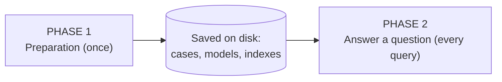
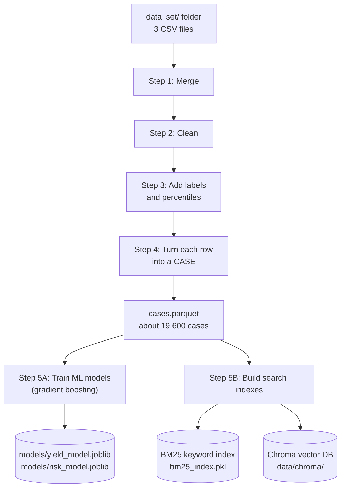
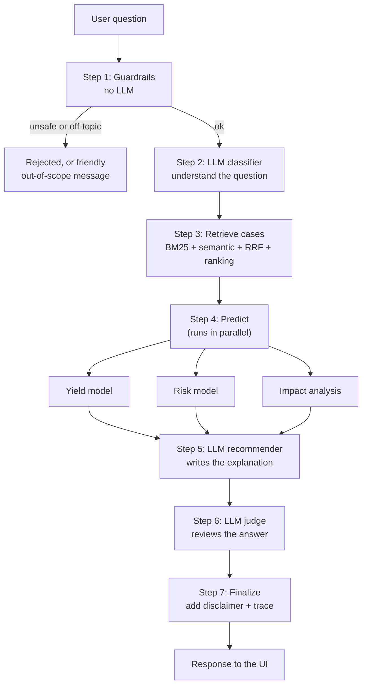
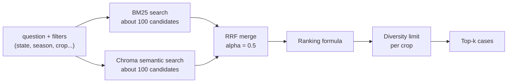

# The Project in Two Phases (Simple Version)

The whole project is two phases:

- **Phase 1: Preparation.** Done once, ahead of time. Turns raw data into cases, trained models and search indexes.
- **Phase 2: Answering.** Happens every time a user asks a question. It only *uses* what Phase 1 built.



---

## Phase 1: Preparation (run once with `make setup`)

### The big picture



Step 5A (models) and Step 5B (search indexes) do not depend on each other. Both just read the same cases.

### Step 1: Merge the three CSV files
**Files:** `scripts/download_data.py`

| File in `data_set/` | What it has | Joined by |
|---|---|---|
| `crop_yield.csv` | crop, state, season, year, area, production, fertilizer, pesticide, **yield** | the main table |
| `state_soil_data.csv` | N, P, K, pH | state |
| `state_weather_data_1997_2020.csv` | temperature, rainfall, humidity | state + year |

Fertilizer and pesticide totals are divided by area, to get kg/ha.

### Step 2: Clean
**Files:** `backend/app/data/ingest.py` (`clean_and_prepare_dataset`)

- Fix column names and capitalisation.
- Drop rows missing crop, state or yield. Drop duplicates.
- Clip values to sensible ranges (for example pH 0 to 14).
- Fill other missing values with the crop's median.
- Drop 94 rows whose yield is more than 10 times the crop's median (recording mistakes).

Result: 19,689 rows become 19,595 clean rows.

### Step 3: Add labels and percentiles
**Files:** `backend/app/data/features.py`

- Rainfall, N, P, K, temperature and humidity become **low / medium / high** labels, using cut-offs saved in `thresholds.json`.
- Every row gets a **yield percentile within its crop** (0 to 100). A value of 90 means this was a better yield than 90% of that crop's records.

### Step 4: Turn each row into a case
**Files:** `backend/app/data/ingest.py` (`construct_case_narrative`, `df_to_documents`)

Each row gets an ID such as `CASE-012806` and a sentence like:

> *Rice grown in Punjab during Kharif 2012. Soil: N 150, P 42, K 43 (high nitrogen), pH 6.5 (neutral). Weather: 26.5°C, 1200 mm rainfall (high), 80% humidity. Inputs: fertilizer 120 kg/ha, pesticide 2.1 kg/ha. Area 1500 ha, production 4200, yield 2.80 t/ha (top 30% for Rice).*

The row's numbers are also kept as **metadata** (crop, state, season, year, yield, and so on). Metadata is used for filtering.

> **Important:** the yield in a case is the **real historical value** from the CSV. No ML model computes it.

### Step 5A: Train the ML models
**Files:** `scripts/train_models.py`, `backend/app/ml/yield_model.py`, `risk_model.py`, `features.py`

Both models use **gradient boosting**. This is many small decision trees, where each new tree fixes the mistakes of the earlier ones.

| | Yield model | Risk model |
|---|---|---|
| Question it answers | "What yield is expected?" | "What is the chance of a poor yield?" |
| Learns | yield (on a log scale) | 1 if yield is in the worst 25% of that crop, else 0 |
| Output | yield + low/high range | probability + low/medium/high level |
| Saved to | `models/yield_model.joblib` | `models/risk_model.joblib` |

Inputs: crop, season, state, N, P, K, pH, temperature, rainfall, humidity, fertilizer, pesticide, area, year.

**Train and test split by time:** train on years before 2016, test on 2016 to 2020. This mimics forecasting a future season.

The yield range comes from how wrong the model was on the test years (10th to 90th percentile of errors). The risk model is also *calibrated*, so "30%" really means about 30%.

Measured results (`models/metrics.json`):
- Yield: R² 0.957, median error about 22.6%, the range holds the true value 80% of the time.
- Risk: ROC-AUC 0.83, accuracy 0.856.

### Step 5B: Build the search indexes
**Files:** `scripts/build_index.py`, `backend/app/retrieval/bm25.py`, `vectorstore.py`

Two indexes are built from the same case sentences. **Nothing is merged or scored here.**

| Index | How it finds cases | Stored in |
|---|---|---|
| **BM25 (keyword)** | exact words: "Punjab", "Rice", "Kharif" | `data/processed/bm25_index.pkl` |
| **Semantic (vector)** | similar meaning: "low rain" is close to "water-scarce". An embedding model turns each case into a list of numbers | ChromaDB in `data/chroma/` |

Embedding 19,600 cases is the slow part, so it runs once and is saved. Each embedding model gets its own collection (for example `cases__ollama__nomic_embed_text`).

### Phase 1 output (all saved to disk)

```
data/processed/cases.parquet      <- cleaned cases
data/processed/thresholds.json    <- low/medium/high cut-offs
data/processed/bm25_index.pkl     <- keyword index
data/chroma/                      <- vector index
models/yield_model.joblib         <- trained yield model
models/risk_model.joblib          <- trained risk model
```

If any of these are missing when the server starts, the app rebuilds what it can automatically.

---

## Phase 2: Answering a question (every `POST /api/v1/query`)

Nothing is trained or indexed here. The system only reads what Phase 1 saved.

### The big picture



### Step 1: Guardrails (no LLM)
**Files:** `backend/app/guardrails/input_validation.py`, `agents/nodes.py::guardrail_node`

- 5 to 1000 characters, strip odd characters.
- Block prompt-injection tricks (returns HTTP 400).
- Check the question is about farming (otherwise it is returned as `out_of_scope`).
- Check numbers are physically possible (pH 0 to 14, humidity 0 to 100 and so on; returns HTTP 422).
- Per-IP rate limit (60 requests per minute).

This is cheap and fast, and it stops bad input before an LLM is used.

### Step 2: The LLM understands the question
**Files:** `agents/classifier.py`

The LLM turns *"Which crops do well in Punjab during Kharif with N around 90 and pH 6.5?"* into structured fields: intent, crop, state, season, N, pH and so on.

- A **regex extractor** also pulls out the numbers, so they don't depend on the LLM alone.
- Names are fixed to the dataset's spelling ("mustard" becomes `Rapeseed &Mustard`).
- If the user names a state that isn't in the data, a warning is added.

### Step 3: Retrieve the best cases
**Files:** `retrieval/hybrid.py`, `vectorstore.py`, `bm25.py`, `ranking.py`, `agents/nodes.py::retriever_node`



1. **Both searches** use the same question and the same filters. Each returns about 100 candidate cases.
2. **RRF (Reciprocal Rank Fusion)** merges the two lists using only *positions*, not scores:
   `score = 0.5 × 1/(60 + rank_in_semantic) + 0.5 × 1/(60 + rank_in_BM25)`.
   A case near the top of both lists wins. The scores are rescaled to 0 to 1.
3. **Ranking formula** re-scores each case with more signals:

| Signal | Weight | Meaning |
|---|---|---|
| Search score (RRF) | 0.35 | how well the text matches |
| Condition proximity | 0.25 | how close the case's numbers are to the ones you stated |
| Yield percentile | 0.20 | prefers cases with good yields |
| Recency | 0.10 | prefers newer years |
| Feedback | 0.10 | past user ratings |
| Prevalence | 0.30 | how widely this crop is grown in that state and season |

   The weights are divided by their sum (1.30) at the end.
4. **Diversity:** at most about a third of the results can be the same crop, so alternatives show up.
5. **Not enough cases?** If fewer than 3 match, filters are relaxed step by step (soil/weather labels, then crop and season, then state). Filters the user set explicitly are never dropped.

If the embedding service is down, it falls back to BM25 only and adds a warning.

### Step 4: Predict (three analyses run at the same time)
**Files:** `agents/nodes.py`, `ml/yield_model.py`, `risk_model.py`, `impact.py`, `yield_gap.py`

First, the top 5 crops found in the retrieved cases are the **candidate crops**. For each one, the system builds a **farm profile**. This is the single input row the models need:

1. Values **you stated** in your query (highest priority).
2. Anything missing is filled from **the median of the retrieved cases for that crop**.
3. Anything still missing is filled from **that crop's historical median**.

Then the three analysts run:

| Analyst | What it does | Output |
|---|---|---|
| **Yield model** | predicts yield for each candidate crop's profile | e.g. `3.20 t/ha`, range `2.8 to 5.3` |
| **Risk model** | predicts the chance of a poor yield, and checks your stated numbers against the crop's normal range | e.g. `P(low) = 6%`, level `low` |
| **Impact analysis** | shuffles each input to see how much accuracy drops (importance), and nudges inputs ±20% to see the yield change (what-if) | "rainfall matters most" |

Notes:
- The models only take a profile; they never read the retrieved cases themselves.
- The cases only fill the gaps in the profile.
- For "why is Punjab's yield higher than Bihar's?" questions, a yield-gap analysis also runs.

### Step 5: LLM recommender writes the answer
**Files:** `agents/recommender.py`, `guardrails/output_validation.py`

1. **Group** the retrieved cases by crop. For each crop, work out the case count, median yield and average score. The top 5 crops are kept.
2. **Attach** the ML yield and risk predictions to each crop.
3. **Ask the LLM** to write an explanation using only these facts, citing `CASE-xxxxxx` IDs.
4. **Output guardrails** then check the text:
   - Unknown case IDs are replaced with `[Unverified Case Reference]`.
   - Sentences containing numbers that can't be traced to the cases, the model outputs or the question are deleted.
   - If more than half of the numeric sentences fail, a fixed template replaces the LLM text.

Rule to remember: **the LLM only writes the words; the numbers come from data and models.**

### Step 6: LLM judge reviews the answer
**Files:** `agents/judge.py`

The judge reads the question, the cases, the recommendations (with predictions) and the draft explanation. It scores four things from 1 to 5:

- **Grounded:** are claims backed by cases?
- **Consistent with data:** do the history and the predictions agree?
- **Actionable:** is it useful?
- **Safe:** nothing harmful, such as dosage advice.

The answer **passes** if every score is at least 3 and the average is at least 3.5. This is calculated in code, not by the LLM. The judge does not rewrite anything. The result is just shown alongside the answer.

### Step 7: Finalize
Adds the disclaimer, an out-of-scope message if needed, and a timing trace of every step. The API then returns:

> similar cases, recommendations (each with supporting case IDs, historical yield, predicted yield and range, and risk), impact analysis, yield gap (if any), explanation, judge verdict, agent trace, which LLM was used, any warnings, and the filters applied.

### If the LLM is unavailable

Every LLM step has a fallback chain: chosen provider (Ollama), then the other (OpenAI), then **degraded mode**:

| Step | Degraded-mode replacement |
|---|---|
| Classifier | regex extractor |
| Recommender | fixed text template |
| Judge | rule-based checks |

The response says `degraded_mode: true`, so you can tell.

---

## Phase 1 and Phase 2 side by side

| | Phase 1: Preparation | Phase 2: Answering |
|---|---|---|
| When | Once (`make setup`), or on first start | Every question |
| Speed | Minutes (embedding is slowest) | Seconds |
| Input | `data_set/` CSVs | A user question |
| Trains models? | Yes (gradient boosting) | **No**, only uses them |
| Builds indexes? | Yes (BM25 + Chroma) | **No**, only searches them |
| Uses RRF? | **No** | Yes, merges the two searches |
| Uses LLM? | No (only an embedding model) | Yes: classifier, recommender, judge |
| Output | files on disk | the answer shown in the UI |

## Where each key idea lives

| Idea | When | File |
|---|---|---|
| Cleaning, cases, yield percentile | Phase 1 | `data/ingest.py`, `data/features.py` |
| Gradient boosting training | Phase 1 | `ml/yield_model.py`, `ml/risk_model.py` |
| BM25 and Chroma indexes | Phase 1 | `retrieval/bm25.py`, `retrieval/vectorstore.py` |
| Guardrails | Phase 2, step 1 | `guardrails/input_validation.py` |
| Classifier | Phase 2, step 2 | `agents/classifier.py` |
| RRF and ranking | Phase 2, step 3 | `retrieval/hybrid.py`, `retrieval/ranking.py` |
| Yield, risk and impact prediction | Phase 2, step 4 | `ml/*.py`, `agents/nodes.py` |
| Recommender and number checks | Phase 2, step 5 | `agents/recommender.py`, `guardrails/output_validation.py` |
| Judge | Phase 2, step 6 | `agents/judge.py` |
| Graph wiring | Phase 2 | `agents/graph.py` |
